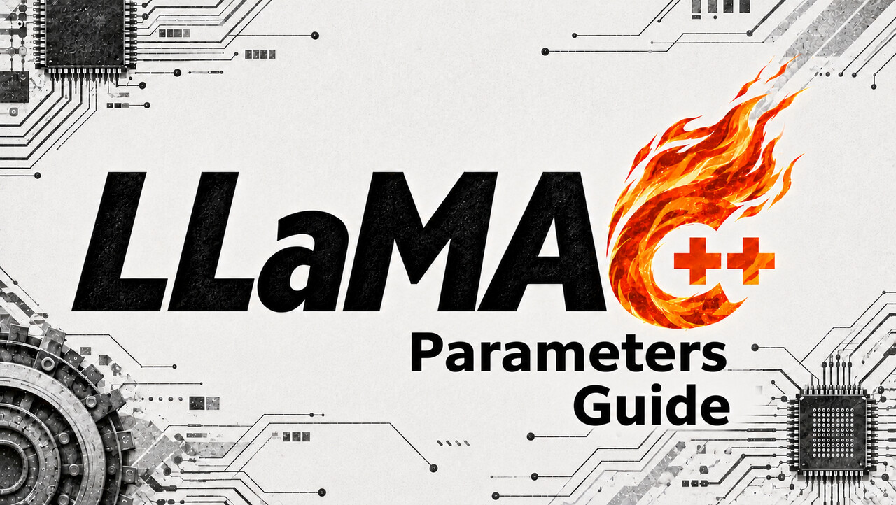

 
 
A [reference for the main llama.cpp commands and parameters](https://github.com/peterplv/llama.cpp.help). It covers the main inference utilities: llama-cli, llama-completion, and llama-server. It includes all the commands and parameters you can get by running, for example, "llama-cli \-\-help" or "llama-server \-\-help", in the same order. I went through all the arguments one by one and tried to write short but, I hope, clear comments for each of them.

I don't use all of **llama.cpp**'s features in my work, so I had to study a significant part of the parameters using AI, the available original documentation, and, in some cases, the source code. This was not simple copy-pasting of **LLM** answers or information from the Web. I tried to understand how each parameter works: how it is designed, what it affects, where it comes from, etc. Only after I understood a parameter (in some cases better, in others less so) did I write a short comment in my own words, as I understood it myself.

Parameters whose descriptions I'm not fully sure about are marked with the following text: 
**\[Note: The description of how the parameter works does not claim to be absolutely complete or accurate\]**

For each parameter, I first give its name, template, and short description from the built-in **llama.cpp** help. After that comes my more detailed comment.

This reference does not claim to be the most accurate and complete explanation of the main **llama.cpp** commands and parameters, but I hope it will be useful, including for beginners.

Originally, I just wanted to understand all of **llama.cpp**'s features for myself, because I use this tool very often. In the end, it turned into a full reference and weeks of digging. I hope the time wasn’t wasted.

The reference will have 4 sections (parameter categories), in the same order as they appear in the main CLI utilities (for example: "llama-cli \-\-help"). The categories are: Common Params, Sampling Params, Speculative Params, Example-Specific Params.

A brief overview of the categories:
 
**Common Params**
 
General parameters. For the most part, they are shared by all utilities (**llama-cli**, **llama-completion**, **llama-server**). This is the largest group of parameters. This series of articles starts with Common Params.

**Sampling Params**
 
Sampling parameters. For example, temperature, top-p, top-k, min-p, and so on, but not only these. Sampling parameters also overlap heavily between utilities. I admit I was very surprised when I looked more closely at how many ways **llama.cpp** offers to configure model behavior through sampling.

**Speculative Params**
 
Speculative decoding parameters. Settings related to using draft models.

**Note**: A draft model is a small, fast model that works together with the main (large) model. It quickly predicts several next tokens and passes them to the main model for verification. If the prediction is confirmed, the main model accepts these tokens without generating them step by step on its own, which speeds up overall text generation.

**Example-Specific Params**
 
Parameters specific to a particular utility. For example, **llama-server** has its own parameters for the server side. These parameters are not available in **llama-cli**, **llama-completion**, and so on. Each utility has its own specific parameters, and the number varies between utilities. llama-server has a significant share of them. You might take the word "specific" to mean "rarely used", but that is not true. This category includes, among others, very important parameters needed for regular work.

So, link to the reference: [https://github.com/peterplv/llama.cpp.help](https://github.com/peterplv/llama.cpp.help).